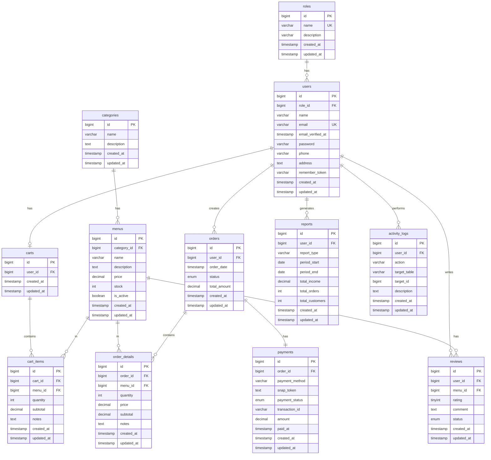

## 2.2.2 Deskripsi Kelas dan Atribut

Dokumen ini menulis ulang seluruh kelas yang muncul pada class diagram CitaRasa Order menggunakan format tabel seperti contoh (atribut terpisah dari fungsi). Kelas dikelompokkan menurut layer: View, Controller, Service, dan Model.

---

### 2.2.2.1 View Layer

#### 1. MenuView
Menangani tampilan daftar menu dan detail menu untuk pelanggan umum.

**Deskripsi atribut kelas MenuView**

| Nama atribut | Tipe Data | Deskripsi |
| --- | --- | --- |
| – | – | Tidak menyimpan state (Blade stateless). |

**Deskripsi fungsi pada kelas MenuView**

| Nama fungsi | Input | Output | Deskripsi |
| --- | --- | --- | --- |
| `index()` | – | Halaman daftar menu | Menampilkan semua menu aktif dengan filter kategori. |
| `show()` | `menuId: int` | Halaman detail menu | Menampilkan detail menu lengkap beserta review. |

#### 2. CartView
Menampilkan isi keranjang belanja pelanggan.

| Nama atribut | Tipe Data | Deskripsi |
| --- | --- | --- |
| – | – | Tidak ada state khusus. |

| Nama fungsi | Input | Output | Deskripsi |
| --- | --- | --- | --- |
| `index()` | – | Halaman keranjang | Menampilkan item, subtotal, dan aksi update/hapus. |

#### 3. CheckoutView
Menangani tampilan pembayaran Snap Midtrans.

| Nama atribut | Tipe Data | Deskripsi |
| --- | --- | --- |
| – | – | – |

| Nama fungsi | Input | Output | Deskripsi |
| --- | --- | --- | --- |
| `index()` | `orderId: int` | Halaman checkout | Ringkasan order + tombol “Bayar Sekarang”. |

#### 4. OrdersView
Menangani riwayat pesanan dan detail order pelanggan.

| Nama atribut | Tipe Data | Deskripsi |
| --- | --- | --- |
| – | – | – |

| Nama fungsi | Input | Output | Deskripsi |
| --- | --- | --- | --- |
| `index()` | – | Halaman riwayat pesanan | Daftar semua order user, bisa difilter status. |
| `show()` | `orderId: int` | Halaman detail order | Memuat detail, status, dan tombol invoice. |

#### 5. ReviewView
Menangani form dan tampilan review menu dari pelanggan.

| Nama atribut | Tipe Data | Deskripsi |
| --- | --- | --- |
| – | – | – |

| Nama fungsi | Input | Output | Deskripsi |
| --- | --- | --- | --- |
| `create()` | `menuId: int` | Form review | Form rating dan komentar. |
| `detail()` | `reviewId: int` | Halaman review | Menampilkan isi review tertentu. |

#### 6. ProfileView
Menangani halaman profil dan pengaturan akun pengguna.

| Nama atribut | Tipe Data | Deskripsi |
| --- | --- | --- |
| – | – | – |

| Nama fungsi | Input | Output | Deskripsi |
| --- | --- | --- | --- |
| `edit()` | – | Halaman profil | Form edit data diri & password. |

#### 7. AuthView
Menangani halaman autentikasi (login, register, reset password).

| Nama atribut | Tipe Data | Deskripsi |
| --- | --- | --- |
| – | – | – |

| Nama fungsi | Input | Output | Deskripsi |
| --- | --- | --- | --- |
| `login()` | – | Halaman login | Form autentikasi. |
| `register()` | – | Halaman register | Form registrasi pelanggan. |
| `forgotPassword()` | – | Halaman lupa password | Form permintaan reset. |

#### 8. AdminView
Menangani dashboard dan fitur administrasi sistem.

| Nama atribut | Tipe Data | Deskripsi |
| --- | --- | --- |
| – | – | – |

| Nama fungsi | Input | Output | Deskripsi |
| --- | --- | --- | --- |
| `dashboard()` | – | Dashboard admin | Ringkasan menu/pesanan/review. |
| `menus()` | – | Halaman kelola menu | Akses CRUD menu & kategori. |
| `orders()` | – | Halaman pesanan admin | Monitoring & update status order. |
| `reviews()` | – | Halaman moderasi review | Approve/hide/reject ulasan pelanggan. |

#### 9. OwnerView
Menangani dashboard pemilik dan laporan bisnis.

| Nama atribut | Tipe Data | Deskripsi |
| --- | --- | --- |
| – | – | – |

| Nama fungsi | Input | Output | Deskripsi |
| --- | --- | --- | --- |
| `dashboard()` | – | Dashboard owner | Highlight performa bisnis. |
| `reports()` | – | Halaman laporan | Daftar laporan harian/bulanan/top menu. |
| `activityLogs()` | – | Halaman aktivitas | Tabel log admin/owner. |

---

### 2.2.2.2 Controller Layer
Seluruh controller Laravel bersifat stateless; dependensi diperoleh via method injection.

Untuk menghindari repetisi, atributnya tidak ada (mengikut contoh “Supplier” yang hanya menuliskan fungsi).

#### 1. MenuController
Mengelola tampilan menu publik untuk pelanggan.

**Deskripsi atribut kelas MenuController**

| Nama atribut | Tipe Data | Deskripsi |
| --- | --- | --- |
| – | – | Controller stateless, tidak menyimpan atribut. |

**Deskripsi fungsi pada kelas MenuController**

| index() |
| --- |
| **Input** | Request (filter kategori, pencarian) |
| **Output** | View dengan daftar menu |
| **Deskripsi** | Mengambil semua menu aktif dari database beserta kategori untuk ditampilkan ke pelanggan. |

| show(Menu $menu) |
| --- |
| **Input** | Menu model (route model binding) |
| **Output** | View detail menu |
| **Deskripsi** | Menampilkan detail menu tertentu lengkap dengan review dan informasi kategori. |

#### 2. CartController
Mengelola operasi CRUD keranjang belanja pelanggan.

**Deskripsi atribut kelas CartController**

| Nama atribut | Tipe Data | Deskripsi |
| --- | --- | --- |
| – | – | Controller stateless, tidak menyimpan atribut. |

**Deskripsi fungsi pada kelas CartController**

| index() |
| --- |
| **Input** | Request |
| **Output** | View keranjang |
| **Deskripsi** | Menampilkan isi keranjang user dengan total harga dan opsi checkout. |

| add(Request) |
| --- |
| **Input** | menu_id: int, quantity: int, notes: string |
| **Output** | JSON response atau redirect |
| **Deskripsi** | Menambah item ke keranjang setelah validasi stok menu tersedia. |

| update(Request, CartItem) |
| --- |
| **Input** | quantity: int, notes: string, CartItem model |
| **Output** | JSON response atau redirect |
| **Deskripsi** | Memperbarui jumlah atau catatan item dalam keranjang. |

| remove(CartItem) |
| --- |
| **Input** | CartItem model |
| **Output** | JSON response atau redirect |
| **Deskripsi** | Menghapus item tertentu dari keranjang user. |

| clear() |
| --- |
| **Input** | – |
| **Output** | Redirect |
| **Deskripsi** | Mengosongkan seluruh isi keranjang user. |

#### 3. OrderController
Mengelola proses pemesanan dan pembayaran pelanggan.

**Deskripsi atribut kelas OrderController**

| Nama atribut | Tipe Data | Deskripsi |
| --- | --- | --- |
| – | – | Controller stateless, tidak menyimpan atribut. |

**Deskripsi fungsi pada kelas OrderController**

| index(Request) |
| --- |
| **Input** | Request dengan filter status |
| **Output** | View daftar pesanan |
| **Deskripsi** | Menampilkan riwayat pesanan user dengan opsi filter berdasarkan status. |

| store(Request) |
| --- |
| **Input** | Data keranjang user |
| **Output** | View pembayaran atau JSON response |
| **Deskripsi** | Membuat pesanan baru, detail pesanan, payment pending, dan generate Snap token Midtrans. |

| continuePayment(Request, Order) |
| --- |
| **Input** | Request, Order model |
| **Output** | View halaman Snap |
| **Deskripsi** | Validasi kepemilikan order dan menampilkan halaman pembayaran dengan Snap token tersimpan. |

| refreshSnapToken(Request, Order) |
| --- |
| **Input** | Request, Order model |
| **Output** | JSON dengan token baru |
| **Deskripsi** | Regenerasi Snap token Midtrans untuk order yang masih pending. |

| downloadInvoice(Request, Order) |
| --- |
| **Input** | Request, Order model |
| **Output** | File PDF |
| **Deskripsi** | Generate dan download invoice pesanan dalam format PDF. |

| show(Request, Order) |
| --- |
| **Input** | Request, Order model |
| **Output** | View detail pesanan |
| **Deskripsi** | Menampilkan detail pesanan lengkap dengan status dan item yang dipesan. |

#### 4. PaymentController
Menangani notifikasi pembayaran dari Midtrans.

**Deskripsi atribut kelas PaymentController**

| Nama atribut | Tipe Data | Deskripsi |
| --- | --- | --- |
| – | – | Controller stateless, tidak menyimpan atribut. |

**Deskripsi fungsi pada kelas PaymentController**

| notification(Request) |
| --- |
| **Input** | Request GET/POST dari Midtrans |
| **Output** | JSON response |
| **Deskripsi** | Menangani health-check (GET) dan notifikasi status pembayaran (POST) dari Midtrans untuk update status payment dan order. |

#### 5. ReviewController
Mengelola review dan rating menu dari pelanggan.

**Deskripsi atribut kelas ReviewController**

| Nama atribut | Tipe Data | Deskripsi |
| --- | --- | --- |
| – | – | Tidak menyimpan atribut (controller stateless). |

**Deskripsi fungsi pada kelas ReviewController**

| store(Request) |
| --- |
| **Input** | rating: int, comment: string, menu_id: int |
| **Output** | Redirect atau JSON response |
| **Deskripsi** | Memvalidasi dan menyimpan review baru untuk menu yang sudah dipesan user. |

| destroy(Review $review) |
| --- |
| **Input** | Review model (milik user saat ini) |
| **Output** | Redirect |
| **Deskripsi** | Menghapus review milik pengguna ketika ia menarik kembali ulasan tersebut. |

#### 6. ProfileController
Mengelola profil dan pengaturan akun pengguna.

**Deskripsi atribut kelas ProfileController**

| Nama atribut | Tipe Data | Deskripsi |
| --- | --- | --- |
| – | – | Tidak menyimpan atribut (controller stateless). |

**Deskripsi fungsi pada kelas ProfileController**

| edit(Request) |
| --- |
| **Input** | Request |
| **Output** | View profil |
| **Deskripsi** | Menampilkan form pengeditan profil dan informasi akun. |

| update(ProfileUpdateRequest) |
| --- |
| **Input** | Data profil baru (nama, email, password opsional) |
| **Output** | Redirect |
| **Deskripsi** | Memvalidasi dan menyimpan perubahan informasi profil/pengaturan baru. |

| destroy(Request) |
| --- |
| **Input** | Password konfirmasi |
| **Output** | Redirect |
| **Deskripsi** | Menghapus akun user secara permanen setelah verifikasi password. |

#### 7. AuthenticatedSessionController
Menangani proses login dan logout pengguna.

**Deskripsi atribut kelas AuthenticatedSessionController**

| Nama atribut | Tipe Data | Deskripsi |
| --- | --- | --- |
| – | – | Tidak menyimpan atribut (controller stateless). |

**Deskripsi fungsi pada kelas AuthenticatedSessionController**

| create() |
| --- |
| **Input** | – |
| **Output** | View login |
| **Deskripsi** | Menampilkan form login standar. |

| store(LoginRequest) |
| --- |
| **Input** | email: string, password: string |
| **Output** | Redirect (dashboard/halaman sebelumnya) |
| **Deskripsi** | Memvalidasi kredensial dan membuat sesi login pengguna. |

| destroy(Request) |
| --- |
| **Input** | Request |
| **Output** | Redirect |
| **Deskripsi** | Mengakhiri sesi login (logout) dan mengarahkan user ke halaman utama. |

#### 8. RegisteredUserController
Menangani proses registrasi pengguna baru.

**Deskripsi atribut kelas RegisteredUserController**

| Nama atribut | Tipe Data | Deskripsi |
| --- | --- | --- |
| – | – | Tidak menyimpan atribut (controller stateless). |

**Deskripsi fungsi pada kelas RegisteredUserController**

| create() |
| --- |
| **Input** | – |
| **Output** | View register |
| **Deskripsi** | Menampilkan form registrasi pengguna baru. |

| store(Request) |
| --- |
| **Input** | name: string, email: string, password: string |
| **Output** | Redirect |
| **Deskripsi** | Memvalidasi dan menyimpan akun baru lalu login otomatis/redirect ke halaman berikutnya. |

#### 9. AdminMenuController
Mengelola CRUD menu dan kategori di area admin.

**Deskripsi atribut kelas AdminMenuController**

| Nama atribut | Tipe Data | Deskripsi |
| --- | --- | --- |
| – | – | Tidak menyimpan atribut (controller stateless). |

**Deskripsi fungsi pada kelas AdminMenuController**

| index() |
| --- |
| **Input** | – |
| **Output** | View daftar menu admin |
| **Deskripsi** | Menampilkan seluruh menu beserta aksi edit/hapus untuk admin. |

| create() |
| --- |
| **Input** | – |
| **Output** | View form tambah menu |
| **Deskripsi** | Menampilkan form pembuatan menu baru beserta kategori. |

| store(Request) |
| --- |
| **Input** | Data menu baru (nama, kategori, harga, stok, gambar) |
| **Output** | Redirect |
| **Deskripsi** | Memvalidasi dan menyimpan menu baru ke database. |

| show(Menu $menu) |
| --- |
| **Input** | Menu model |
| **Output** | View detail menu |
| **Deskripsi** | Menampilkan detail menu untuk keperluan review admin. |

| edit(Menu $menu) |
| --- |
| **Input** | Menu model |
| **Output** | View form edit |
| **Deskripsi** | Menampilkan form untuk mengubah data menu yang ada. |

| update(Request, Menu $menu) |
| --- |
| **Input** | Data menu terbaru, Menu model |
| **Output** | Redirect |
| **Deskripsi** | Memvalidasi dan menyimpan perubahan pada menu yang dipilih. |

| destroy(Menu $menu) |
| --- |
| **Input** | Menu model |
| **Output** | Redirect |
| **Deskripsi** | Menghapus menu dari database beserta aset terkait. |

#### 10. CategoryController
Mengelola kategori menu dan tampilan menu per kategori.

**Deskripsi atribut kelas CategoryController**

| Nama atribut | Tipe Data | Deskripsi |
| --- | --- | --- |
| – | – | Tidak menyimpan atribut (controller stateless). |

**Deskripsi fungsi pada kelas CategoryController**

| index() |
| --- |
| **Input** | – |
| **Output** | View daftar kategori |
| **Deskripsi** | Menampilkan seluruh kategori beserta jumlah menu di tiap kategori. |

| show(Category $category) |
| --- |
| **Input** | Category model |
| **Output** | View detail kategori |
| **Deskripsi** | Menampilkan informasi kategori dan daftar menu yang termasuk di dalamnya. |

| store(Request) |
| --- |
| **Input** | Data kategori baru (nama, deskripsi) |
| **Output** | Redirect |
| **Deskripsi** | Menyimpan kategori baru ke database. |

| update(Request, Category $category) |
| --- |
| **Input** | Data kategori terbaru, Category model |
| **Output** | Redirect |
| **Deskripsi** | Memperbarui informasi kategori yang sudah ada. |

| destroy(Category $category) |
| --- |
| **Input** | Category model |
| **Output** | Redirect |
| **Deskripsi** | Menghapus kategori beserta hubungan menu yang terkait. |

#### 11. AdminOrderController
Mengelola monitoring dan update status pesanan di admin.

**Deskripsi atribut kelas AdminOrderController**

| Nama atribut | Tipe Data | Deskripsi |
| --- | --- | --- |
| – | – | Tidak menyimpan atribut (controller stateless). |

**Deskripsi fungsi pada kelas AdminOrderController**

| index() |
| --- |
| **Input** | – |
| **Output** | View daftar order admin |
| **Deskripsi** | Menampilkan semua pesanan customer dengan filter status untuk admin. |

| show(Order $order) |
| --- |
| **Input** | Order model |
| **Output** | View detail order |
| **Deskripsi** | Menampilkan detail pesanan termasuk item, pembayaran, dan status terkini. |

| updateStatus(Request, Order $order) |
| --- |
| **Input** | status baru, Order model |
| **Output** | Redirect |
| **Deskripsi** | Memperbarui status pesanan (diproses, selesai, batal) dan menyimpan ke database. |

#### 12. AdminReviewController
Mengelola moderasi dan persetujuan review pelanggan.

**Deskripsi atribut kelas AdminReviewController**

| Nama atribut | Tipe Data | Deskripsi |
| --- | --- | --- |
| – | – | Tidak menyimpan atribut (controller stateless). |

**Deskripsi fungsi pada kelas AdminReviewController**

| index() |
| --- |
| **Input** | – |
| **Output** | View moderasi review |
| **Deskripsi** | Menampilkan daftar review yang masuk beserta statusnya. |

| show(Review $review) |
| --- |
| **Input** | Review model |
| **Output** | View detail review |
| **Deskripsi** | Menampilkan isi review secara lengkap untuk ditinjau admin. |

| approve(Review $review) |
| --- |
| **Input** | Review model |
| **Output** | Redirect |
| **Deskripsi** | Menyetujui review dan menampilkannya di halaman menu. |

| hide(Review $review) |
| --- |
| **Input** | Review model |
| **Output** | Redirect |
| **Deskripsi** | Menyembunyikan review dari halaman publik tanpa menghapusnya. |

| unhide(Review $review) |
| --- |
| **Input** | Review model |
| **Output** | Redirect |
| **Deskripsi** | Mengembalikan review tersembunyi agar muncul lagi ke publik. |

| reject(Review $review) |
| --- |
| **Input** | Review model |
| **Output** | Redirect |
| **Deskripsi** | Menolak review (dianggap tidak sesuai) dan menghapusnya. |

| bulkAction(Request) |
| --- |
| **Input** | daftar review_id, aksi (approve/hide/reject) |
| **Output** | Redirect |
| **Deskripsi** | Melakukan moderasi massal terhadap beberapa review sekaligus. |

#### 13. OwnerReportController
Mengelola laporan bisnis dan export PDF untuk owner.

**Deskripsi atribut kelas OwnerReportController**

| Nama atribut | Tipe Data | Deskripsi |
| --- | --- | --- |
| – | – | Tidak menyimpan atribut (controller stateless). |

**Deskripsi fungsi pada kelas OwnerReportController**

| dailyReport(Request) |
| --- |
| **Input** | tanggal: date |
| **Output** | View laporan harian |
| **Deskripsi** | Menampilkan ringkasan penjualan dan pesanan pada tanggal tertentu. |

| dailyReportPdf(Request) |
| --- |
| **Input** | tanggal: date |
| **Output** | File PDF |
| **Deskripsi** | Menghasilkan file PDF dari laporan penjualan harian. |

| monthlyReport(Request) |
| --- |
| **Input** | bulan: date |
| **Output** | View laporan bulanan |
| **Deskripsi** | Menampilkan ringkasan penjualan dan omzet per bulan. |

| monthlyReportPdf(Request) |
| --- |
| **Input** | bulan: date |
| **Output** | File PDF |
| **Deskripsi** | Menghasilkan file PDF dari laporan penjualan bulanan. |

| topMenusReport(Request) |
| --- |
| **Input** | rentang waktu (tanggal awal & akhir) |
| **Output** | View laporan menu terlaris |
| **Deskripsi** | Menampilkan daftar menu dengan penjualan tertinggi pada periode tertentu. |

| topMenusReportPdf(Request) |
| --- |
| **Input** | rentang waktu |
| **Output** | File PDF |
| **Deskripsi** | Menghasilkan file PDF dari laporan menu terlaris. |

#### 14. OwnerActivityLogController
Mengelola tampilan log aktivitas sistem untuk owner.

**Deskripsi atribut kelas OwnerActivityLogController**

| Nama atribut | Tipe Data | Deskripsi |
| --- | --- | --- |
| – | – | Tidak menyimpan atribut (controller stateless). |

**Deskripsi fungsi pada kelas OwnerActivityLogController**

| index(Request) |
| --- |
| **Input** | filter tanggal, aksi |
| **Output** | View log aktivitas |
| **Deskripsi** | Menampilkan daftar log aktivitas admin/owner berdasarkan filter yang dipilih. |

| downloadPdf(Request) |
| --- |
| **Input** | filter tanggal, aksi |
| **Output** | File PDF |
| **Deskripsi** | Mengekspor log aktivitas ke format PDF sesuai filter. |

---

### 2.2.2.3 Service Layer

#### ActivityLogger
Menyediakan helper tunggal untuk menulis ke tabel `activity_logs`.

| Nama atribut | Tipe Data | Deskripsi |
| --- | --- | --- |
| – | – | Stateless (hanya berisi fungsi statis). |

| Nama fungsi | Input | Output | Deskripsi |
| --- | --- | --- | --- |
| `log()` | `action: string`, `table: string`, `targetId: ?int`, `description: string` | void | Membuat entri log baru dengan `user_id` dari `Auth::id()`. |

---

### 2.2.2.4 Model Layer (Eloquent)

#### 1. User
Model pengguna sistem (pelanggan, admin, owner).

**Deskripsi atribut kelas User**

| Nama atribut | Tipe Data | Deskripsi |
| --- | --- | --- |
| `id` | int | Primary key. |
| `name` | string | Nama pengguna. |
| `email` | string | Email unik. |
| `password` | string | Password terenkripsi. |
| `role_id` | int | Relasi ke tabel `roles`. |
| `email_verified_at` | datetime | Tanggal verifikasi email. |

**Deskripsi fungsi pada kelas User**

| role() |
| --- |
| **Input** | – |
| **Output** | `belongsTo Role` |
| **Deskripsi** | Mengambil role yang dimiliki user. |

| orders() |
| --- |
| **Input** | – |
| **Output** | `hasMany Order` |
| **Deskripsi** | Mengambil daftar pesanan milik user. |

| reviews() |
| --- |
| **Input** | – |
| **Output** | `hasMany Review` |
| **Deskripsi** | Mengambil review yang pernah ditulis user. |

| activityLogs() |
| --- |
| **Input** | – |
| **Output** | `hasMany ActivityLog` |
| **Deskripsi** | Mengambil log aktivitas user di sistem. |

#### 2. Role
Model peran pengguna dalam sistem.

**Deskripsi atribut kelas Role**

| Nama atribut | Tipe Data | Deskripsi |
| --- | --- | --- |
| `id` | int | Primary key. |
| `name` | string | Nama peran (admin/owner/customer). |

**Deskripsi fungsi pada kelas Role**

| users() |
| --- |
| **Input** | – |
| **Output** | `hasMany User` |
| **Deskripsi** | Mengambil semua user yang menggunakan role ini. |

#### 3. Category
Model kategori menu makanan/minuman.

**Deskripsi atribut kelas Category**

| Nama atribut | Tipe Data | Deskripsi |
| --- | --- | --- |
| `id` | int | Primary key. |
| `name` | string | Nama kategori. |
| `description` | text | Deskripsi kategori. |

**Deskripsi fungsi pada kelas Category**

| menus() |
| --- |
| **Input** | – |
| **Output** | `hasMany Menu` |
| **Deskripsi** | Mengambil seluruh menu yang berada di kategori ini. |

#### 4. Menu
Model menu makanan/minuman yang dijual.

**Deskripsi atribut kelas Menu**

| Nama atribut | Tipe Data | Deskripsi |
| --- | --- | --- |
| `id` | int | Primary key menu. |
| `category_id` | int | Relasi ke kategori menu. |
| `name` | string | Nama menu. |
| `description` | text | Deskripsi menu. |
| `price` | decimal | Harga menu. |
| `stock` | int | Stok menu tersedia. |
| `image_path` | string | Lokasi file gambar menu. |
| `is_active` | bool | Status apakah menu ditampilkan. |

**Deskripsi fungsi pada kelas Menu**

| category() |
| --- |
| **Input** | – |
| **Output** | `belongsTo Category` |
| **Deskripsi** | Mengambil kategori yang menaungi menu ini. |

| orderDetails() |
| --- |
| **Input** | – |
| **Output** | `hasMany OrderDetail` |
| **Deskripsi** | Mengambil detail pesanan yang melibatkan menu ini. |

| reviews() |
| --- |
| **Input** | – |
| **Output** | `hasMany Review` |
| **Deskripsi** | Mengambil review yang diberikan pelanggan untuk menu ini. |

#### 5. Cart
Model keranjang belanja milik pengguna.

**Deskripsi atribut kelas Cart**

| Nama atribut | Tipe Data | Deskripsi |
| --- | --- | --- |
| `id` | int | Primary key keranjang. |
| `user_id` | int | Pengguna pemilik keranjang. |

**Deskripsi fungsi pada kelas Cart**

| user() |
| --- |
| **Input** | – |
| **Output** | `belongsTo User` |
| **Deskripsi** | Mengambil pengguna yang memiliki keranjang ini. |

| items() |
| --- |
| **Input** | – |
| **Output** | `hasMany CartItem` |
| **Deskripsi** | Mengambil daftar item yang ada di dalam keranjang. |

#### 6. CartItem
Model item individual dalam keranjang.

**Deskripsi atribut kelas CartItem**

| Nama atribut | Tipe Data | Deskripsi |
| --- | --- | --- |
| `id` | int | Primary key item keranjang. |
| `cart_id` | int | Relasi ke keranjang induk. |
| `menu_id` | int | Relasi ke menu yang dipilih. |
| `quantity` | int | Jumlah menu yang dipesan. |
| `notes` | text | Catatan khusus dari user. |
| `subtotal` | decimal | Total harga untuk item ini. |

**Deskripsi fungsi pada kelas CartItem**

| cart() |
| --- |
| **Input** | – |
| **Output** | `belongsTo Cart` |
| **Deskripsi** | Mengambil keranjang induk dari item ini. |

| menu() |
| --- |
| **Input** | – |
| **Output** | `belongsTo Menu` |
| **Deskripsi** | Mengambil menu yang terkait dengan item keranjang. |

#### 7. Order
Model pesanan pelanggan.

**Deskripsi atribut kelas Order**

| Nama atribut | Tipe Data | Deskripsi |
| --- | --- | --- |
| `id` | int | Primary key pesanan. |
| `user_id` | int | Pengguna pemilik pesanan. |
| `status` | enum | Status pesanan (pending, paid, dll.). |
| `total_amount` | decimal | Total biaya pesanan. |
| `created_at` | datetime | Waktu pesanan dibuat. |

**Deskripsi fungsi pada kelas Order**

| user() |
| --- |
| **Input** | – |
| **Output** | `belongsTo User` |
| **Deskripsi** | Mengambil pengguna yang membuat pesanan. |

| details() |
| --- |
| **Input** | – |
| **Output** | `hasMany OrderDetail` |
| **Deskripsi** | Mengambil daftar item (detail) di dalam pesanan ini. |

| payment() |
| --- |
| **Input** | – |
| **Output** | `hasOne Payment` |
| **Deskripsi** | Mengambil informasi pembayaran terkait pesanan. |

#### 8. OrderDetail
Model detail item dalam pesanan.

**Deskripsi atribut kelas OrderDetail**

| Nama atribut | Tipe Data | Deskripsi |
| --- | --- | --- |
| `id` | int | Primary key detail pesanan. |
| `order_id` | int | Relasi ke pesanan induk. |
| `menu_id` | int | Menu yang dipesan. |
| `quantity` | int | Jumlah menu. |
| `price` | decimal | Harga satuan saat dipesan. |
| `notes` | text | Catatan khusus item. |
| `subtotal` | decimal | Total harga untuk item ini. |

**Deskripsi fungsi pada kelas OrderDetail**

| order() |
| --- |
| **Input** | – |
| **Output** | `belongsTo Order` |
| **Deskripsi** | Mengambil pesanan induk dari detail ini. |

| menu() |
| --- |
| **Input** | – |
| **Output** | `belongsTo Menu` |
| **Deskripsi** | Mengambil menu yang direferensikan oleh detail ini. |

#### 9. Payment
Model data pembayaran dan transaksi Midtrans.

**Deskripsi atribut kelas Payment**

| Nama atribut | Tipe Data | Deskripsi |
| --- | --- | --- |
| `id` | int | Primary key pembayaran. |
| `order_id` | int | Relasi ke pesanan. |
| `payment_method` | string | Metode pembayaran (Snap, kartu, dll.). |
| `payment_status` | enum | Status pembayaran (pending/sukses/gagal). |
| `transaction_id` | string | ID transaksi dari Midtrans. |
| `amount` | decimal | Nominal yang dibayar. |
| `snap_token` | string | Token Snap terakhir. |
| `paid_at` | datetime | Waktu pembayaran berhasil. |

**Deskripsi fungsi pada kelas Payment**

| order() |
| --- |
| **Input** | – |
| **Output** | `belongsTo Order` |
| **Deskripsi** | Mengambil pesanan yang dibayar oleh record pembayaran ini. |

#### 10. Review
Model ulasan dan rating menu dari pelanggan.

**Deskripsi atribut kelas Review**

| Nama atribut | Tipe Data | Deskripsi |
| --- | --- | --- |
| `id` | int | Primary key review. |
| `user_id` | int | Penulis review. |
| `menu_id` | int | Menu yang dinilai. |
| `rating` | tinyint | Nilai rating (1–5). |
| `comment` | text | Komentar review. |
| `status` | enum | Status moderasi (pending/published/hidden). |

**Deskripsi fungsi pada kelas Review**

| user() |
| --- |
| **Input** | – |
| **Output** | `belongsTo User` |
| **Deskripsi** | Mengambil pengguna yang menulis review ini. |

| menu() |
| --- |
| **Input** | – |
| **Output** | `belongsTo Menu` |
| **Deskripsi** | Mengambil menu yang dinilai pada review ini. |

#### 11. Report
Model laporan bisnis untuk owner.

**Deskripsi atribut kelas Report**

| Nama atribut | Tipe Data | Deskripsi |
| --- | --- | --- |
| `id` | int | Primary key laporan. |
| `type` | string | Jenis laporan (daily/monthly/top-menu). |
| `payload` | json | Isi laporan dalam format JSON. |
| `generated_at` | datetime | Waktu laporan dibuat. |

**Deskripsi fungsi pada kelas Report**

| (tidak ada relasi langsung) |
| --- |
| **Input** | – |
| **Output** | – |
| **Deskripsi** | Data laporan dikumpulkan melalui query khusus; model tidak memiliki relasi Eloquent tambahan. |

#### 12. ActivityLog
Model log aktivitas admin dan owner dalam sistem.

**Deskripsi atribut kelas ActivityLog**

| Nama atribut | Tipe Data | Deskripsi |
| --- | --- | --- |
| `id` | int | Primary key log. |
| `user_id` | int | Pengguna yang melakukan aksi. |
| `action` | string | Jenis aksi (create/update/delete). |
| `target_table` | string | Nama tabel yang dipengaruhi. |
| `target_id` | int | ID record target (opsional). |
| `description` | text | Penjelasan aktivitas. |
| `created_at` | datetime | Waktu aksi dicatat. |

**Deskripsi fungsi pada kelas ActivityLog**

| user() |
| --- |
| **Input** | – |
| **Output** | `belongsTo User` |
| **Deskripsi** | Mengambil user yang melakukan tindakan tersebut. |

---

## 2.3.1 Dekomposisi Data

Bagian ini menjelaskan struktur tabel-tabel yang digunakan dalam sistem CitaRasa Order. Setiap tabel dijelaskan dengan detail atribut, tipe data, konstrain, dan keterangan.

---

### Tabel 1: Struktur Tabel roles

| Nama Field | Tipe Data | Null | Konstrain | Range Nilai | Default | Keterangan |
|:---|:---|:---|:---|:---|:---|:---|
| id | Bigint(20) | No | Primary Key, Auto increment | - | - | Id unik role |
| name | Varchar(255) | No | Unique | - | - | Nama peran (admin/owner/customer) |
| description | Varchar(255) | Yes | - | - | NULL | Deskripsi peran |
| created_at | Timestamp | Yes | - | - | NULL | Waktu data dibuat |
| updated_at | Timestamp | Yes | - | - | NULL | Waktu data terakhir diperbaharui |

---

### Tabel 2: Struktur Tabel users

| Nama Field | Tipe Data | Null | Konstrain | Range Nilai | Default | Keterangan |
|:---|:---|:---|:---|:---|:---|:---|
| id | Bigint(20) | No | Primary Key, Auto increment | - | - | Id unik user |
| role_id | Bigint(20) | Yes | ForeignKey roles(id), onDelete set null | - | NULL | Relasi ke tabel roles |
| name | Varchar(255) | No | - | - | - | Nama lengkap pengguna |
| email | Varchar(255) | No | Unique | - | - | Alamat email akun user |
| email_verified_at | Timestamp | Yes | - | - | NULL | Waktu verifikasi email |
| password | Varchar(255) | No | - | - | - | Password yang sudah di-hash |
| phone | Varchar(255) | Yes | - | - | NULL | Nomor telepon pengguna |
| address | Text | Yes | - | - | NULL | Alamat pengguna |
| remember_token | Varchar(100) | Yes | - | - | NULL | Token untuk remember me |
| created_at | Timestamp | Yes | - | - | NULL | Waktu data dibuat |
| updated_at | Timestamp | Yes | - | - | NULL | Waktu data terakhir diperbaharui |

---

### Tabel 3: Struktur Tabel categories

| Nama Field | Tipe Data | Null | Konstrain | Range Nilai | Default | Keterangan |
|:---|:---|:---|:---|:---|:---|:---|
| id | Bigint(20) | No | Primary Key, Auto increment | - | - | Id unik kategori |
| name | Varchar(255) | No | - | - | - | Nama kategori menu |
| description | Text | Yes | - | - | NULL | Deskripsi kategori |
| created_at | Timestamp | Yes | - | - | NULL | Waktu data dibuat |
| updated_at | Timestamp | Yes | - | - | NULL | Waktu data terakhir diperbaharui |

---

### Tabel 4: Struktur Tabel menus

| Nama Field | Tipe Data | Null | Konstrain | Range Nilai | Default | Keterangan |
|:---|:---|:---|:---|:---|:---|:---|
| id | Bigint(20) | No | Primary Key, Auto increment | - | - | Id unik menu |
| category_id | Bigint(20) | No | ForeignKey categories(id), onDelete cascade | - | - | Relasi ke tabel categories |
| name | Varchar(255) | No | - | - | - | Nama menu makanan/minuman |
| description | Text | Yes | - | - | NULL | Deskripsi menu |
| price | Decimal(12,2) | No | - | >= 0 | - | Harga menu dalam rupiah |
| stock | Integer | No | - | >= 0 | 0 | Stok menu tersedia |
| is_active | Boolean | No | - | true/false | true | Status apakah menu aktif ditampilkan |
| created_at | Timestamp | Yes | - | - | NULL | Waktu data dibuat |
| updated_at | Timestamp | Yes | - | - | NULL | Waktu data terakhir diperbaharui |

---

### Tabel 5: Struktur Tabel carts

| Nama Field | Tipe Data | Null | Konstrain | Range Nilai | Default | Keterangan |
|:---|:---|:---|:---|:---|:---|:---|
| id | Bigint(20) | No | Primary Key, Auto increment | - | - | Id unik keranjang |
| user_id | Bigint(20) | No | ForeignKey users(id), onDelete cascade | - | - | Relasi ke tabel users |
| created_at | Timestamp | Yes | - | - | NULL | Waktu data dibuat |
| updated_at | Timestamp | Yes | - | - | NULL | Waktu data terakhir diperbaharui |

---

### Tabel 6: Struktur Tabel cart_items

| Nama Field | Tipe Data | Null | Konstrain | Range Nilai | Default | Keterangan |
|:---|:---|:---|:---|:---|:---|:---|
| id | Bigint(20) | No | Primary Key, Auto increment | - | - | Id unik item keranjang |
| cart_id | Bigint(20) | No | ForeignKey carts(id), onDelete cascade | - | - | Relasi ke tabel carts |
| menu_id | Bigint(20) | No | ForeignKey menus(id), onDelete cascade | - | - | Relasi ke tabel menus |
| quantity | Integer | No | - | > 0 | 1 | Jumlah menu yang ditambahkan |
| subtotal | Decimal(12,2) | No | - | >= 0 | - | Total harga untuk item ini (quantity × price) |
| notes | Text | Yes | - | - | NULL | Catatan khusus dari user untuk item |
| created_at | Timestamp | Yes | - | - | NULL | Waktu data dibuat |
| updated_at | Timestamp | Yes | - | - | NULL | Waktu data terakhir diperbaharui |

---

### Tabel 7: Struktur Tabel orders

| Nama Field | Tipe Data | Null | Konstrain | Range Nilai | Default | Keterangan |
|:---|:---|:---|:---|:---|:---|:---|
| id | Bigint(20) | No | Primary Key, Auto increment | - | - | Id unik pesanan |
| user_id | Bigint(20) | No | ForeignKey users(id), onDelete cascade | - | - | Relasi ke tabel users |
| order_date | Timestamp | No | - | - | CURRENT_TIMESTAMP | Tanggal dan waktu pesanan dibuat |
| status | Enum | No | - | pending, paid, diproses, selesai, batal | pending | Status pesanan |
| total_amount | Decimal(12,2) | No | - | >= 0 | - | Total biaya pesanan |
| created_at | Timestamp | Yes | - | - | NULL | Waktu data dibuat |
| updated_at | Timestamp | Yes | - | - | NULL | Waktu data terakhir diperbaharui |

---

### Tabel 8: Struktur Tabel order_details

| Nama Field | Tipe Data | Null | Konstrain | Range Nilai | Default | Keterangan |
|:---|:---|:---|:---|:---|:---|:---|
| id | Bigint(20) | No | Primary Key, Auto increment | - | - | Id unik detail pesanan |
| order_id | Bigint(20) | No | ForeignKey orders(id), onDelete cascade | - | - | Relasi ke tabel orders |
| menu_id | Bigint(20) | No | ForeignKey menus(id), onDelete cascade | - | - | Relasi ke tabel menus |
| quantity | Integer | No | - | > 0 | - | Jumlah menu yang dipesan |
| price | Decimal(12,2) | No | - | >= 0 | - | Harga satuan menu saat dipesan |
| subtotal | Decimal(12,2) | No | - | >= 0 | - | Total harga untuk item ini (quantity × price) |
| notes | Text | Yes | - | - | NULL | Catatan khusus untuk item pesanan |
| created_at | Timestamp | Yes | - | - | NULL | Waktu data dibuat |
| updated_at | Timestamp | Yes | - | - | NULL | Waktu data terakhir diperbaharui |

---

### Tabel 9: Struktur Tabel payments

| Nama Field | Tipe Data | Null | Konstrain | Range Nilai | Default | Keterangan |
|:---|:---|:---|:---|:---|:---|:---|
| id | Bigint(20) | No | Primary Key, Auto increment | - | - | Id unik pembayaran |
| order_id | Bigint(20) | No | ForeignKey orders(id), onDelete cascade | - | - | Relasi ke tabel orders |
| payment_method | Varchar(255) | No | - | e-wallet, bank_transfer, qris | - | Metode pembayaran yang digunakan |
| snap_token | Text | Yes | - | - | NULL | Token Snap Midtrans untuk pembayaran |
| payment_status | Enum | No | - | pending, sukses, gagal | pending | Status pembayaran |
| transaction_id | Varchar(255) | Yes | - | - | NULL | ID transaksi dari Midtrans |
| amount | Decimal(12,2) | No | - | >= 0 | - | Nominal yang dibayar |
| paid_at | Timestamp | Yes | - | - | NULL | Waktu pembayaran berhasil |
| created_at | Timestamp | Yes | - | - | NULL | Waktu data dibuat |
| updated_at | Timestamp | Yes | - | - | NULL | Waktu data terakhir diperbaharui |

---

### Tabel 10: Struktur Tabel reviews

| Nama Field | Tipe Data | Null | Konstrain | Range Nilai | Default | Keterangan |
|:---|:---|:---|:---|:---|:---|:---|
| id | Bigint(20) | No | Primary Key, Auto increment | - | - | Id unik review |
| user_id | Bigint(20) | No | ForeignKey users(id), onDelete cascade | - | - | Relasi ke tabel users (penulis review) |
| menu_id | Bigint(20) | No | ForeignKey menus(id), onDelete cascade | - | - | Relasi ke tabel menus (menu yang direview) |
| rating | Tinyint | No | - | 1-5 | - | Nilai rating menu (1 sampai 5) |
| comment | Text | Yes | - | - | NULL | Komentar atau ulasan dari user |
| status | Enum | No | - | pending, approved, hidden | pending | Status moderasi review |
| created_at | Timestamp | Yes | - | - | NULL | Waktu data dibuat |
| updated_at | Timestamp | Yes | - | - | NULL | Waktu data terakhir diperbaharui |

---

### Tabel 11: Struktur Tabel reports

| Nama Field | Tipe Data | Null | Konstrain | Range Nilai | Default | Keterangan |
|:---|:---|:---|:---|:---|:---|:---|
| id | Bigint(20) | No | Primary Key, Auto increment | - | - | Id unik laporan |
| user_id | Bigint(20) | No | ForeignKey users(id), onDelete cascade | - | - | Relasi ke tabel users (owner yang membuat laporan) |
| report_type | Varchar(255) | No | - | penjualan, pendapatan, review, menu terlaris | - | Jenis laporan yang dibuat |
| period_start | Date | No | - | - | - | Tanggal awal periode laporan |
| period_end | Date | No | - | - | - | Tanggal akhir periode laporan |
| total_income | Decimal(15,2) | No | - | >= 0 | 0 | Total pendapatan dalam periode |
| total_orders | Integer | No | - | >= 0 | 0 | Total jumlah pesanan dalam periode |
| total_customers | Integer | No | - | >= 0 | 0 | Total jumlah pelanggan dalam periode |
| created_at | Timestamp | Yes | - | - | NULL | Waktu data dibuat |
| updated_at | Timestamp | Yes | - | - | NULL | Waktu data terakhir diperbaharui |

---

### Tabel 12: Struktur Tabel activity_logs

| Nama Field | Tipe Data | Null | Konstrain | Range Nilai | Default | Keterangan |
|:---|:---|:---|:---|:---|:---|:---|
| id | Bigint(20) | No | Primary Key, Auto increment | - | - | Id unik log aktivitas |
| user_id | Bigint(20) | No | ForeignKey users(id), onDelete cascade | - | - | Relasi ke tabel users (user yang melakukan aksi) |
| action | Varchar(255) | No | - | - | - | Jenis aksi yang dilakukan (Tambah Menu, Ubah Harga, Ubah Status Pesanan, dll) |
| target_table | Varchar(255) | No | - | - | - | Nama tabel yang dipengaruhi oleh aksi |
| target_id | Bigint(20) | Yes | - | - | NULL | ID record target yang diubah (opsional) |
| description | Text | No | - | - | - | Detail aktivitas yang dilakukan |
| created_at | Timestamp | Yes | - | - | NULL | Waktu data dibuat |
| updated_at | Timestamp | Yes | - | - | NULL | Waktu data terakhir diperbaharui |

---

## 2.3.2 Physical Data Model

Bagian ini menjelaskan Physical Data Model (PDM) sistem CitaRasa Order. PDM menggambarkan struktur tabel-tabel database beserta relasi antar tabel melalui primary key (PK) dan foreign key (FK).

### Diagram Physical Data Model

#### Diagram untuk dbdiagram.io

Untuk melihat diagram interaktif dengan relasi yang jelas, copy-paste kode berikut ke [https://dbdiagram.io](https://dbdiagram.io):

```
// Physical Data Model - CitaRasa Order
// Copy-paste kode ini ke https://dbdiagram.io untuk melihat diagram

Table roles {
  id bigint [pk, increment]
  name varchar(255) [unique, not null]
  description varchar(255)
  created_at timestamp
  updated_at timestamp
}

Table users {
  id bigint [pk, increment]
  role_id bigint [ref: > roles.id, note: 'onDelete: set null']
  name varchar(255) [not null]
  email varchar(255) [unique, not null]
  email_verified_at timestamp
  password varchar(255) [not null]
  phone varchar(255)
  address text
  remember_token varchar(100)
  created_at timestamp
  updated_at timestamp
}

Table categories {
  id bigint [pk, increment]
  name varchar(255) [not null]
  description text
  created_at timestamp
  updated_at timestamp
}

Table menus {
  id bigint [pk, increment]
  category_id bigint [ref: > categories.id, note: 'onDelete: cascade']
  name varchar(255) [not null]
  description text
  price decimal(12,2) [not null]
  stock int [default: 0, not null]
  is_active boolean [default: true, not null]
  created_at timestamp
  updated_at timestamp
}

Table carts {
  id bigint [pk, increment]
  user_id bigint [ref: > users.id, note: 'onDelete: cascade']
  created_at timestamp
  updated_at timestamp
}

Table cart_items {
  id bigint [pk, increment]
  cart_id bigint [ref: > carts.id, note: 'onDelete: cascade']
  menu_id bigint [ref: > menus.id, note: 'onDelete: cascade']
  quantity int [default: 1, not null]
  subtotal decimal(12,2) [not null]
  notes text
  created_at timestamp
  updated_at timestamp
}

Table orders {
  id bigint [pk, increment]
  user_id bigint [ref: > users.id, note: 'onDelete: cascade']
  order_date timestamp [default: `CURRENT_TIMESTAMP`, not null]
  status enum [default: 'pending', not null, note: 'pending, paid, diproses, selesai, batal']
  total_amount decimal(12,2) [not null]
  created_at timestamp
  updated_at timestamp
}

Table order_details {
  id bigint [pk, increment]
  order_id bigint [ref: > orders.id, note: 'onDelete: cascade']
  menu_id bigint [ref: > menus.id, note: 'onDelete: cascade']
  quantity int [not null]
  price decimal(12,2) [not null]
  subtotal decimal(12,2) [not null]
  notes text
  created_at timestamp
  updated_at timestamp
}

Table payments {
  id bigint [pk, increment]
  order_id bigint [ref: - orders.id, note: 'onDelete: cascade, one-to-one']
  payment_method varchar(255) [not null, note: 'e-wallet, bank_transfer, qris']
  snap_token text
  payment_status enum [default: 'pending', not null, note: 'pending, sukses, gagal']
  transaction_id varchar(255)
  amount decimal(12,2) [not null]
  paid_at timestamp
  created_at timestamp
  updated_at timestamp
}

Table reviews {
  id bigint [pk, increment]
  user_id bigint [ref: > users.id, note: 'onDelete: cascade']
  menu_id bigint [ref: > menus.id, note: 'onDelete: cascade']
  rating tinyint [not null, note: '1-5']
  comment text
  status enum [default: 'pending', not null, note: 'pending, approved, hidden']
  created_at timestamp
  updated_at timestamp
}

Table reports {
  id bigint [pk, increment]
  user_id bigint [ref: > users.id, note: 'onDelete: cascade']
  report_type varchar(255) [not null, note: 'penjualan, pendapatan, review, menu terlaris']
  period_start date [not null]
  period_end date [not null]
  total_income decimal(15,2) [default: 0, not null]
  total_orders int [default: 0, not null]
  total_customers int [default: 0, not null]
  created_at timestamp
  updated_at timestamp
}

Table activity_logs {
  id bigint [pk, increment]
  user_id bigint [ref: > users.id, note: 'onDelete: cascade']
  action varchar(255) [not null, note: 'Tambah Menu, Ubah Harga, Ubah Status Pesanan, dll']
  target_table varchar(255) [not null]
  target_id bigint
  description text [not null]
  created_at timestamp
  updated_at timestamp
}
```

**Cara menggunakan:**
1. Buka [https://dbdiagram.io](https://dbdiagram.io)
2. Klik "New Project" atau langsung paste kode di atas
3. Diagram akan otomatis ter-generate dengan relasi antar tabel
4. Anda bisa export sebagai PNG, PDF, atau SQL

#### Diagram Mermaid (untuk render di Markdown)



---

### 1. Tabel `roles`
Tabel untuk menyimpan data peran pengguna dalam sistem (admin, owner, customer).

**Primary Key (PK):**
- `id`

**Attributes:**
- `name` (Varchar(255), Unique)
- `description` (Varchar(255), Nullable)
- `created_at` (Timestamp, Nullable)
- `updated_at` (Timestamp, Nullable)

**Foreign Keys (FK):**
- Tidak ada

---

### 2. Tabel `users`
Tabel untuk menyimpan data pengguna sistem (pelanggan, admin, owner).

**Primary Key (PK):**
- `id`

**Attributes:**
- `name` (Varchar(255))
- `email` (Varchar(255), Unique)
- `email_verified_at` (Timestamp, Nullable)
- `password` (Varchar(255))
- `phone` (Varchar(255), Nullable)
- `address` (Text, Nullable)
- `remember_token` (Varchar(100), Nullable)
- `created_at` (Timestamp, Nullable)
- `updated_at` (Timestamp, Nullable)

**Foreign Keys (FK):**
- `role_id` (references `roles.id`, onDelete set null)

---

### 3. Tabel `categories`
Tabel untuk menyimpan data kategori menu makanan dan minuman.

**Primary Key (PK):**
- `id`

**Attributes:**
- `name` (Varchar(255))
- `description` (Text, Nullable)
- `created_at` (Timestamp, Nullable)
- `updated_at` (Timestamp, Nullable)

**Foreign Keys (FK):**
- Tidak ada

---

### 4. Tabel `menus`
Tabel untuk menyimpan data menu makanan dan minuman yang dijual.

**Primary Key (PK):**
- `id`

**Attributes:**
- `name` (Varchar(255))
- `description` (Text, Nullable)
- `price` (Decimal(12,2))
- `stock` (Integer, Default: 0)
- `is_active` (Boolean, Default: true)
- `created_at` (Timestamp, Nullable)
- `updated_at` (Timestamp, Nullable)

**Foreign Keys (FK):**
- `category_id` (references `categories.id`, onDelete cascade)

---

### 5. Tabel `carts`
Tabel untuk menyimpan data keranjang belanja milik pengguna.

**Primary Key (PK):**
- `id`

**Attributes:**
- `created_at` (Timestamp, Nullable)
- `updated_at` (Timestamp, Nullable)

**Foreign Keys (FK):**
- `user_id` (references `users.id`, onDelete cascade)

---

### 6. Tabel `cart_items`
Tabel untuk menyimpan data item individual dalam keranjang belanja.

**Primary Key (PK):**
- `id`

**Attributes:**
- `quantity` (Integer, Default: 1)
- `subtotal` (Decimal(12,2))
- `notes` (Text, Nullable)
- `created_at` (Timestamp, Nullable)
- `updated_at` (Timestamp, Nullable)

**Foreign Keys (FK):**
- `cart_id` (references `carts.id`, onDelete cascade)
- `menu_id` (references `menus.id`, onDelete cascade)

---

### 7. Tabel `orders`
Tabel untuk menyimpan data pesanan pelanggan.

**Primary Key (PK):**
- `id`

**Attributes:**
- `order_date` (Timestamp, Default: CURRENT_TIMESTAMP)
- `status` (Enum: 'pending', 'paid', 'diproses', 'selesai', 'batal', Default: 'pending')
- `total_amount` (Decimal(12,2))
- `created_at` (Timestamp, Nullable)
- `updated_at` (Timestamp, Nullable)

**Foreign Keys (FK):**
- `user_id` (references `users.id`, onDelete cascade)

---

### 8. Tabel `order_details`
Tabel untuk menyimpan data detail item dalam pesanan.

**Primary Key (PK):**
- `id`

**Attributes:**
- `quantity` (Integer)
- `price` (Decimal(12,2))
- `subtotal` (Decimal(12,2))
- `notes` (Text, Nullable)
- `created_at` (Timestamp, Nullable)
- `updated_at` (Timestamp, Nullable)

**Foreign Keys (FK):**
- `order_id` (references `orders.id`, onDelete cascade)
- `menu_id` (references `menus.id`, onDelete cascade)

---

### 9. Tabel `payments`
Tabel untuk menyimpan data pembayaran dan transaksi Midtrans.

**Primary Key (PK):**
- `id`

**Attributes:**
- `payment_method` (Varchar(255))
- `snap_token` (Text, Nullable)
- `payment_status` (Enum: 'pending', 'sukses', 'gagal', Default: 'pending')
- `transaction_id` (Varchar(255), Nullable)
- `amount` (Decimal(12,2))
- `paid_at` (Timestamp, Nullable)
- `created_at` (Timestamp, Nullable)
- `updated_at` (Timestamp, Nullable)

**Foreign Keys (FK):**
- `order_id` (references `orders.id`, onDelete cascade)

---

### 10. Tabel `reviews`
Tabel untuk menyimpan data ulasan dan rating menu dari pelanggan.

**Primary Key (PK):**
- `id`

**Attributes:**
- `rating` (TinyInteger, Range: 1-5)
- `comment` (Text, Nullable)
- `status` (Enum: 'pending', 'approved', 'hidden', Default: 'pending')
- `created_at` (Timestamp, Nullable)
- `updated_at` (Timestamp, Nullable)

**Foreign Keys (FK):**
- `user_id` (references `users.id`, onDelete cascade)
- `menu_id` (references `menus.id`, onDelete cascade)

---

### 11. Tabel `reports`
Tabel untuk menyimpan data laporan bisnis yang dibuat oleh owner.

**Primary Key (PK):**
- `id`

**Attributes:**
- `report_type` (Varchar(255))
- `period_start` (Date)
- `period_end` (Date)
- `total_income` (Decimal(15,2), Default: 0)
- `total_orders` (Integer, Default: 0)
- `total_customers` (Integer, Default: 0)
- `created_at` (Timestamp, Nullable)
- `updated_at` (Timestamp, Nullable)

**Foreign Keys (FK):**
- `user_id` (references `users.id`, onDelete cascade)

---

### 12. Tabel `activity_logs`
Tabel untuk menyimpan log aktivitas admin dan owner dalam sistem.

**Primary Key (PK):**
- `id`

**Attributes:**
- `action` (Varchar(255))
- `target_table` (Varchar(255))
- `target_id` (BigInteger, Nullable)
- `description` (Text)
- `created_at` (Timestamp, Nullable)
- `updated_at` (Timestamp, Nullable)

**Foreign Keys (FK):**
- `user_id` (references `users.id`, onDelete cascade)

---

### Ringkasan Relasi

Diagram Physical Data Model menunjukkan hubungan antar tabel sebagai berikut:

- **`users`** adalah tabel sentral yang terhubung dengan:
  - `roles` (melalui `role_id`)
  - `carts` (sebagai pemilik keranjang)
  - `orders` (sebagai pembuat pesanan)
  - `reviews` (sebagai penulis review)
  - `reports` (sebagai pembuat laporan)
  - `activity_logs` (sebagai pelaku aktivitas)

- **`categories`** terhubung dengan:
  - `menus` (satu kategori memiliki banyak menu)

- **`menus`** terhubung dengan:
  - `categories` (setiap menu memiliki satu kategori)
  - `cart_items` (menu dapat ditambahkan ke keranjang)
  - `order_details` (menu dapat dipesan)
  - `reviews` (menu dapat direview)

- **`carts`** terhubung dengan:
  - `users` (setiap keranjang dimiliki oleh satu user)
  - `cart_items` (satu keranjang memiliki banyak item)

- **`orders`** terhubung dengan:
  - `users` (setiap pesanan dibuat oleh satu user)
  - `order_details` (satu pesanan memiliki banyak detail)
  - `payments` (setiap pesanan memiliki satu pembayaran)

- **`order_details`** terhubung dengan:
  - `orders` (setiap detail milik satu pesanan)
  - `menus` (setiap detail merujuk ke satu menu)

- **`payments`** terhubung dengan:
  - `orders` (setiap pembayaran untuk satu pesanan)

- **`reviews`** terhubung dengan:
  - `users` (setiap review ditulis oleh satu user)
  - `menus` (setiap review untuk satu menu)

- **`reports`** terhubung dengan:
  - `users` (setiap laporan dibuat oleh satu user/owner)

- **`activity_logs`** terhubung dengan:
  - `users` (setiap log aktivitas dilakukan oleh satu user)

