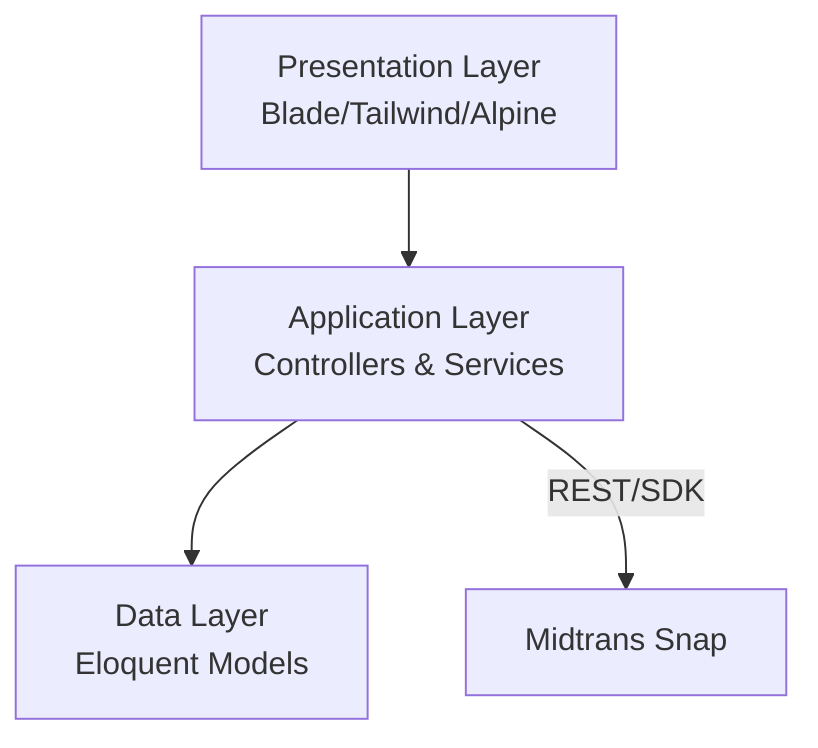
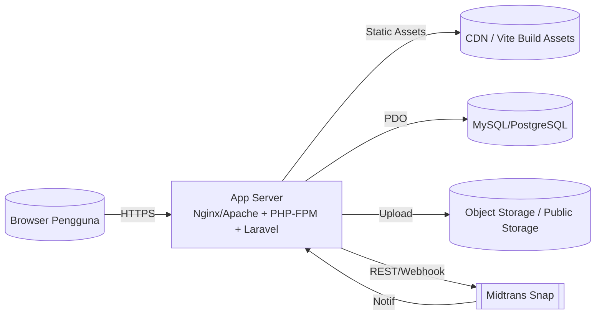

# Dokumen Perancangan Perangkat Lunak (DPPL) – CitaRasa Order

## 1. Pendahuluan

Dokumen Perancangan Perangkat Lunak (DPPL) ini berisi informasi yang dibutuhkan tim pengembang untuk merancang aplikasi CitaRasa Order. Di dalamnya terdapat penjelasan tentang arsitektur, data, antarmuka, serta pokok teknis lain yang menjadi dasar pengembangan.

### 1.1 Tujuan Penulisan Dokumen

Dokumen ini disusun untuk menjadi panduan tim pengembang ketika membangun sistem pemesanan makanan berbasis web bernama CitaRasa Order. Isi dokumen menjelaskan rancangan arsitektur, basis data, antarmuka pengguna, dan hubungan antarkomponen. Dokumen juga memberi gambaran teknis kepada analis, pengembang, serta pemangku kepentingan lain supaya proses implementasi dan pengujian berjalan sesuai kebutuhan pada dokumen Spesifikasi Kebutuhan Perangkat Lunak (SKPL).

### 1.2 Ruang Lingkup

Produk yang dirancang adalah sistem pemesanan makanan berbasis web dengan framework Laravel dan payment gateway Midtrans.

Peran utama dalam sistem:

1. Pelanggan melihat menu, memesan, dan membayar secara daring.
2. Admin mengelola menu, pesanan, dan review pelanggan.
3. Owner memantau laporan penjualan dan aktivitas sistem.

Hal yang tidak dicakup:

1. Manajemen keuangan lengkap seperti pajak atau akuntansi.
2. Manajemen stok bahan baku dapur.
3. Aplikasi mobile native (hanya versi web).

Tujuan utama sistem adalah membuat proses pemesanan lebih efisien, meminimalkan kesalahan pencatatan, dan memberi pengalaman pemesanan digital yang mudah bagi pelanggan.

### 1.3 Definisi, Akronim, dan Singkatan

**Definisi**

- Application Programming Interface (API) — Cara CitaRasa Order bertukar data dengan layanan lain seperti Midtrans.
- Authentication — Proses memastikan pengguna yang masuk adalah pengguna terdaftar.
- Authorization — Proses memberi hak akses sesuai peran (owner, admin, pelanggan).
- Backend — Bagian sistem yang mengelola logika bisnis, database, dan komunikasi dengan frontend (Laravel).
- Database — Tempat menyimpan data pengguna, menu, pesanan, dan transaksi.
- Framework — Kerangka kerja untuk mempercepat pengembangan, dalam proyek ini memakai Laravel.
- Frontend — Antarmuka yang digunakan owner, admin, dan pelanggan melalui browser.
- Menu — Daftar makanan/minuman Rumah Makan Cita Rasa yang bisa dipesan.
- Midtrans — Layanan payment gateway untuk memproses pembayaran digital.
- Order — Data transaksi pesanan pelanggan yang diproses admin.
- Payment Gateway — Sistem perantara antara pelanggan dan bank/penyedia pembayaran.
- Snap Js — Komponen Midtrans yang menampilkan halaman pembayaran langsung.

**Akronim dan Singkatan**

- API — Application Programming Interface
- DBMS — Database Management System
- ERD — Entity Relationship Diagram
- HTTP — Hypertext Transfer Protocol
- MVC — Model View Controller
- RDBMS — Relational Database Management System
- SRS — Software Requirements Specification
- SUS — System Usability Scale
- UI — User Interface

### 1.4 Referensi

1. IEEE Std 830-1998, IEEE Recommended Practice for Software Requirements Specifications, IEEE, 1998.

## 2. Perancangan Sistem

### 2.1 Perancangan Arsitektur

Bagian ini menjelaskan arsitektur CitaRasa Order dan cara tiap komponen saling terhubung.

#### Overview Sistem

CitaRasa Order adalah aplikasi pemesanan makanan berbasis web yang terdiri dari tiga bagian utama. Ketiganya saling terhubung melalui HTTP/REST API sehingga pelanggan, admin, dan owner dapat memakai sistem dengan nyaman.

1. **Frontend** — Antarmuka yang dibuat dengan Blade, Tailwind CSS, dan Alpine.js. Bagian ini menampilkan menu, keranjang, proses checkout, serta dashboard admin/owner sesuai hak akses.
2. **Backend** — Aplikasi Laravel 11 yang menangani login, hak akses per peran, alur pesanan, integrasi Midtrans Snap (membuat token dan menerima callback), pembuatan laporan, serta pencatatan aktivitas.
3. **Database** — Basis data relasional (SQLite saat pengembangan, MySQL/PostgreSQL di produksi) yang menyimpan data pengguna, menu, kategori, keranjang, pesanan, pembayaran, review, laporan, dan log aktivitas.

Alur kerjanya sederhana: klien mengakses frontend, frontend meneruskan permintaan ke backend lewat API, backend mengolah data dan menyimpan/ambil data dari database, lalu backend berkomunikasi dengan Midtrans untuk pembayaran.

#### Arsitektur Perangkat Lunak

Arsitektur perangkat lunak mengikuti pola tiga lapisan supaya alur data dan tugas tiap bagian jelas:

1. **Presentation Layer** — Lapisan antarmuka web berbasis Blade, Tailwind CSS, dan Alpine.js. Lapisan ini menerima input pengguna, menampilkan data hasil olahan application layer, dan mengirim permintaan ke backend melalui HTTP/REST.
2. **Application Layer** — Lapisan logika bisnis yang dijalankan oleh Laravel (controller, service, middleware). Lapisan ini menangani pengelolaan data pengguna, pesanan, pembayaran, laporan, autentikasi, otorisasi, serta komunikasi dua arah antara presentation layer dan data layer. Integrasi Midtrans Snap (pembuatan token dan penerimaan notifikasi) juga berada di sini.
3. **Data Layer** — Lapisan penyimpanan data menggunakan database relasional (SQLite pada pengembangan dan MySQL/PostgreSQL di produksi). Lapisan ini diwakili oleh model Eloquent dan migrasi yang menyimpan seluruh data menu, kategori, keranjang, pesanan, pembayaran, review, laporan, dan aktivitas sistem.

#### Deployment Diagram

Sistem akan dijalankan di server Linux dengan Nginx/Apache dan PHP-FPM. Diagram berikut menunjukkan hubungan antar komponen saat dipasang di lingkungan produksi:

- **Browser** mengakses aplikasi lewat HTTPS dari perangkat desktop maupun mobile.
- **Web server** menjalankan Laravel, menangani autentikasi, dan mengirim respons halaman atau JSON.
- **Database** menyimpan seluruh data penting; bisa ditambah backup atau replikasi bila dibutuhkan.
- **Object storage** menyimpan gambar menu, bukti pembayaran, dan laporan PDF.
- **Midtrans Snap** memproses pembayaran dan mengirim notifikasi status ke backend supaya status pesanan ikut diperbarui.

Bagian selanjutnya dari DPPL akan membahas perancangan rinci (diagram kelas, ERD, desain antarmuka, dan skenario interaksi) agar implementasi sesuai kebutuhan SKPL.

### 2.2 Diagram Kelas Utama

#### Daftar Komponen MVC Aktual

Untuk menjaga DPPL tetap sejalan dengan kode, berikut daftar lengkap komponen MVC yang ada saat ini.

- **Controller Layer**
  - `app/Http/Controllers/MenuController`, `OrderController`, `CartController`, `CategoryController`, `PaymentController`, `ProfileController`, `ReviewController`
  - Controller auth bawaan Breeze di `app/Http/Controllers/Auth/*` (`AuthenticatedSessionController`, `RegisteredUserController`, `PasswordResetLinkController`, `NewPasswordController`, `PasswordController`, `VerifyEmailController`, `EmailVerificationPromptController`, `EmailVerificationNotificationController`, `ConfirmablePasswordController`)
  - Admin area `app/Http/Controllers/Admin/*` (`DashboardController`, `MenuController`, `OrderController`, `ProfileController`) dan `AdminReviewController`
  - Owner area `app/Http/Controllers/Owner/*` (`DashboardController`, `ReportController`, `ActivityLogController`, `ProfileController`)
  - API khusus `app/Http/Controllers/Api/RealtimeController`

- **Model Layer**
  - `app/Models/User`, `Role`, `Category`, `Menu`, `Cart`, `CartItem`, `Order`, `OrderDetail`, `Payment`, `Review`, `Report`, `ActivityLog`

- **View Layer (Blade)**
  - Direktori `resources/views` meliputi:
    - `layouts`, `components`, dan `vendor/*` untuk template dasar & komponen Blade
    - Halaman publik: `menus`, `orders`, `cart`, `payment`, `reviews`, `profile`
    - Halaman auth di `auth/*`
    - Admin dashboard di `admin/*` (kategori, menu, pesanan, review, profil)
    - Owner dashboard di `owner/*` (dashboard, laporan PDF, activity log, profil)
    - Partial tambahan seperti `menus/partials`, `profile/partials`, dan error pages di `errors/*`

Diagram berikut merangkum hubungan inti di antara komponen utama. Struktur mengikuti pola **Model–View–Controller (MVC)** khas Laravel dengan tambahan **service** untuk integrasi Midtrans dan pencatatan aktivitas. Tidak ada repository khusus; controller langsung berinteraksi dengan model Eloquent atau service yang tersedia.

#### Diagram Kelas Detail (Versi Lengkap)

Diagram berikut meniru gaya contoh penuh yang menampilkan setiap kelompok view, controller, service, dan model yang ada di proyek. Gunakan diagram ini bila diperlukan bukti visual yang komprehensif untuk DPPL.

```mermaid
classDiagram
    %% View Layer
    class MenuView {
        +index()
        +show()
    }
    class CartView {
        +index()
    }
    class CheckoutView {
        +index()
        +status()
    }
    class ReviewView {
        +index()
        +showForm()
    }
    class ProfileView {
        +index()
        +edit()
    }
    class AdminView {
        +dashboard()
        +menus()
        +orders()
        +reviews()
        +profile()
    }
    class OwnerView {
        +dashboard()
        +reports()
        +activityLogs()
        +profile()
    }
    class AuthView {
        +login()
        +register()
        +forgotPassword()
        +verifyEmail()
    }

    %% Controller Layer - Umum
    class MenuController {
        +index()
        +show()
        +store()
        +update()
        +destroy()
    }
    class CartController {
        +index()
        +store()
        +update()
        +destroy()
    }
    class OrderController {
        +index()
        +checkout()
        +store()
        +updateStatus()
        +show()
    }
    class PaymentController {
        +createSnapToken()
        +handleCallback()
        +showInvoice()
    }
    class ReviewController {
        +store()
        +updateStatus()
    }
    class ProfileController {
        +edit()
        +update()
        +destroy()
    }
    class CategoryController {
        +index()
        +store()
        +update()
        +destroy()
    }

    %% Controller Layer - Auth
    class AuthenticatedSessionController {
        +create()
        +store()
        +destroy()
    }
    class RegisteredUserController {
        +create()
        +store()
    }
    class PasswordResetLinkController {
        +create()
        +store()
    }
    class NewPasswordController {
        +create()
        +store()
    }
    class VerifyEmailController {
        +__invoke()
    }
    class EmailVerificationPromptController {
        +__invoke()
    }
    class EmailVerificationNotificationController {
        +store()
    }
    class ConfirmablePasswordController {
        +show()
        +store()
    }
    class PasswordController {
        +update()
    }

    %% Controller Layer - Admin
    class AdminDashboardController {
        +index()
    }
    class AdminMenuController {
        +index()
        +store()
        +update()
        +destroy()
    }
    class AdminOrderController {
        +index()
        +updateStatus()
        +show()
    }
    class AdminProfileController {
        +edit()
        +update()
    }
    class AdminReviewController {
        +index()
        +updateStatus()
    }

    %% Controller Layer - Owner
    class OwnerDashboardController {
        +index()
    }
    class OwnerReportController {
        +index()
        +exportPdf()
    }
    class OwnerActivityLogController {
        +index()
    }
    class OwnerProfileController {
        +edit()
        +update()
    }

    %% Controller Layer - API
    class RealtimeController {
        +index()
    }

    %% Service Layer
    class MidtransService {
        +createSnapToken(order)
        +handleNotification(payload)
        +verifySignature(payload)
    }
    class ActivityLogger {
        +log(userId, action, target, description)
    }

    %% Model Layer
    class User {
        +id: int
        +name: string
        +email: string
        +password: string
        +role_id: int
    }
    class Role {
        +id: int
        +name: string
    }
    class Category {
        +id: int
        +name: string
        +description: text
    }
    class Menu {
        +id: int
        +category_id: int
        +name: string
        +price: decimal
        +description: text
        +image_path: string
        +is_active: bool
    }
    class Cart {
        +id: int
        +user_id: int
    }
    class CartItem {
        +id: int
        +cart_id: int
        +menu_id: int
        +quantity: int
        +notes: text
    }
    class Order {
        +id: int
        +user_id: int
        +status: string
        +total_amount: decimal
    }
    class OrderDetail {
        +id: int
        +order_id: int
        +menu_id: int
        +quantity: int
        +unit_price: decimal
        +notes: text
    }
    class Payment {
        +id: int
        +order_id: int
        +payment_method: string
        +payment_status: string
        +transaction_id: string
        +snap_token: string
    }
    class Review {
        +id: int
        +user_id: int
        +menu_id: int
        +rating: int
        +comment: text
        +status: string
    }
    class Report {
        +id: int
        +type: string
        +payload: json
    }
    class ActivityLog {
        +id: int
        +user_id: int
        +action: string
        +target_table: string
        +description: text
    }

    %% Relationships
    MenuView --> MenuController
    CartView --> CartController
    CheckoutView --> OrderController
    ReviewView --> ReviewController
    ProfileView --> ProfileController
    AuthView --> AuthenticatedSessionController
    AuthView --> RegisteredUserController
    AdminView --> AdminDashboardController
    AdminView --> AdminMenuController
    AdminView --> AdminOrderController
    AdminView --> AdminReviewController
    AdminView --> AdminProfileController
    OwnerView --> OwnerDashboardController
    OwnerView --> OwnerReportController
    OwnerView --> OwnerActivityLogController
    OwnerView --> OwnerProfileController

    MenuController --> Menu
    MenuController --> Category
    CartController --> Cart
    CartController --> CartItem
    OrderController --> Order
    OrderController --> OrderDetail
    OrderController --> Payment
    PaymentController --> Payment
    PaymentController --> MidtransService
    ReviewController --> Review
    ProfileController --> User
    CategoryController --> Category
    AdminMenuController --> Menu
    AdminOrderController --> Order
    AdminOrderController --> Payment
    AdminReviewController --> Review
    OwnerReportController --> Report
    OwnerActivityLogController --> ActivityLog
    RealtimeController --> Order

    MidtransService --> Payment
    ActivityLogger --> ActivityLog

    User --> Role
    Order --> User
    Order --> OrderDetail
    Order --> Payment
    Cart --> User
    CartItem --> Menu
    Review --> User
    Review --> Menu
```

```mermaid
classDiagram
    %% View Layer (Blade)
    class MenuView {
        +renderMenuList()
        +renderDetail()
        +showFlashMessage()
    }
    class CheckoutView {
        +renderCart()
        +renderCheckout()
        +showPaymentStatus()
    }
    class DashboardView {
        +renderOverview()
        +renderReports()
        +showActivityLog()
    }

    %% Controller Layer
    class MenuController {
        +index()
        +store()
        +show()
        +update()
        +destroy()
    }
    class OrderController {
        +index()
        +checkout()
        +store()
        +show()
        +updateStatus()
    }
    class PaymentController {
        +createSnapToken()
        +handleCallback()
        +showInvoice()
    }
    class ReviewController {
        +store()
        +updateStatus()
    }
    class ReportController {
        +index()
        +exportPdf()
    }

    %% Service Layer (tersedia di proyek)
    class MidtransService {
        +createSnapToken(order)
        +handleNotification(payload)
        +verifySignature(payload)
    }
    class ActivityLogger {
        +log(userId, action, target, description)
    }

    %% Model Layer (Eloquent)
    class User {
        +id: int
        +name: string
        +email: string
        +password: string
        +role: string
        +email_verified_at: datetime
        +created_at: datetime
        +updated_at: datetime
        +orders()
        +reviews()
    }
    class Menu {
        +id: int
        +category_id: int
        +name: string
        +price: decimal
        +description: text
        +image_path: string
        +status: string
        +created_at: datetime
        +updated_at: datetime
        +category()
        +orderDetails()
    }
    class Order {
        +id: int
        +user_id: int
        +status: string
        +total_amount: decimal
        +order_date: datetime
        +notes: text
        +details()
        +payment()
    }
    class OrderDetail {
        +id: int
        +order_id: int
        +menu_id: int
        +quantity: int
        +unit_price: decimal
        +notes: text
        +menu()
    }
    class Payment {
        +id: int
        +order_id: int
        +payment_method: string
        +payment_status: string
        +transaction_id: string
        +amount: decimal
        +paid_at: datetime
        +snap_token: string
    }
    class Review {
        +id: int
        +user_id: int
        +menu_id: int
        +rating: int
        +comment: text
        +status: string
    }
    class Report {
        +id: int
        +type: string
        +payload: json
        +generated_at: datetime
    }
    class ActivityLog {
        +id: int
        +user_id: int
        +action: string
        +target_table: string
        +target_id: int
        +description: text
    }
```

- **View** direpresentasikan oleh template Blade seperti `MenuView`, `CheckoutView`, dan `DashboardView`.
- **Controller** yang benar-benar ada (`MenuController`, `OrderController`, `PaymentController`, `ReviewController`, `ReportController`) menangani request dan memanggil model/service.
- **Service** seperti `MidtransService` (integrasi Snap) dan `ActivityLogger` (pencatatan admin) tersedia di folder `app/Services`.
- **Model** mengikuti kelas Eloquent nyata (`User`, `Menu`, `Order`, `OrderDetail`, `Payment`, `Review`, `Report`, `ActivityLog`).

Struktur ini mencerminkan kondisi kode saat ini sehingga dokumen DPPL tetap akurat dan mudah dirujuk tim pengembang.

